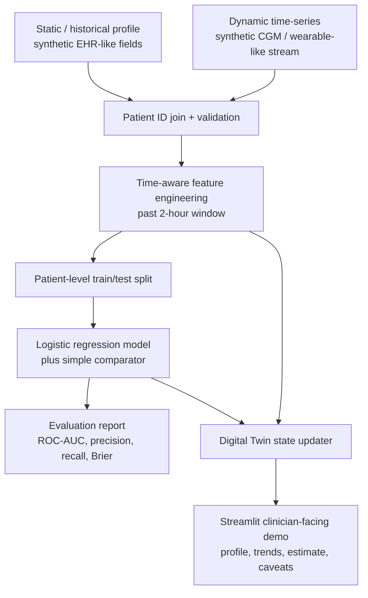

# GlucoTwin Architecture

## Data flow

1. The static profile generator produces fictional demographics and baseline fields.
2. The sensor generator produces timestamped synthetic glucose, steps, heart rate, sleep proxy and simulated meal inputs.
3. Both streams are linked using a synthetic patient ID.
4. Features use only past readings at the prediction timestamp; labels are based on the following two hours.
5. The classifier is evaluated with a patient-level split.
6. The dashboard replays a selected patient's stream and updates features and the model estimate as the replay position changes.

## Non-goals

This prototype does not establish a clinical digital twin, validated physiological simulation, or safe clinical decision support.
